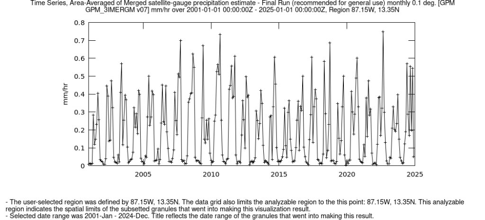

# Validación independiente con NASA Giovanni — Caso Choluteca

**Fecha:** 2026-11-15  
**Proyecto:** ALTARIS — Earth Trend Intelligence (NASA Space Apps Challenge 2026, "Be An Earth System Trend Detective")  
**Caso verificado:** Ejemplo 1 · Choluteca, Corredor Seco (Honduras) · celda `N1335W08715` · 13.35°N, 87.15°O  
**Indicador:** lluvia de temporada, suma mayo–octubre (mm/temporada), 2001–2024  

---

## 1. Qué hicimos y por qué

El análisis de ALTARIS se calcula con nuestros propios scripts, que descargan IMERG desde el archivo GES DISC. Ninguna herramienta de la lista del reto (Giovanni, Hydrology Time Series, AppEEARS, Climate Data Online) forma parte de ese cálculo.

Para contrastar el resultado, extrajimos **una serie independiente de la misma celda** con **NASA Giovanni**, una de las herramientas que lista el reto, y comparamos contra la salida del pipeline.

**Alcance:** esto es una **verificación de un caso**. No sustituye nuestro pipeline ni valida por sí sola el resto de celdas. No se debe describir como «usamos Giovanni» para el análisis.

---

## 2. Parámetros en Giovanni (v 4.40)

| Parámetro | Valor |
|---|---|
| Tipo de gráfica | Time Series, Area-Averaged |
| Variable | Merged satellite-gauge precipitation estimate – Final Run (recommended for general use), `GPM_3IMERGM v07`, mensual, 0.1°, mm/hr |
| Periodo | 2001-01-01 a 2024-12-31 |
| Región | `-87.15,13.35,-87.15,13.35` (un solo punto; Giovanni confirma que la región analizable es ese punto) |
| Datos descargados | CSV `docs/validacion_giovanni/g4.areaAvgTimeSeries.GPM_3IMERGM_07_precipitation.20010101-20241231.87W_13N_87W_13N.csv` |

**Enlace para reproducir el resultado en Giovanni** (requiere cuenta Earthdata):

```
https://giovanni.gsfc.nasa.gov/giovanni/#service=ArAvTs&starttime=2001-01-01T00:00:00Z&endtime=2024-12-31T23:59:59Z&bbox=-87.15,13.35,-87.15,13.35&data=GPM_3IMERGM_07_precipitation&variableFacets=dataFieldMeasurement%3APrecipitation%3B&dataKeyword=IMERG&portal=GIOVANNI&format=json
```

---

## 3. Gráfica generada directamente en NASA Giovanni



---

## 4. Cálculo aplicado a la serie de Giovanni

1. Giovanni entrega la tasa media mensual en **mm/hora**. Se convirtió a mm por mes multiplicando por `24 × días reales del mes` (años bisiestos incluidos).
2. Se sumaron mayo a octubre de cada año (24 años completos, 2001–2024).
3. Se calculó la **pendiente de Sen** (Theil-Sen) con su **IC 95 %**, expresada por década, y una prueba de tendencia de Kendall (scipy `kendalltau`), equivalente a Mann–Kendall sin corrección por empates.

### Totales mayo–octubre obtenidos (mm/temporada)

| Año | mm | Año | mm | Año | mm |
|---|---|---|---|---|---|
| 2001 | 1061.0 | 2009 | 1179.4 | 2017 | 1572.6 |
| 2002 | 1404.0 | 2010 | 2103.6 | 2018 | 1418.9 |
| 2003 | 1546.0 | 2011 | 2069.8 | 2019 | 1131.2 |
| 2004 | 1346.3 | 2012 | 1470.4 | 2020 | 1669.2 |
| 2005 | 1527.0 | 2013 | 1256.9 | 2021 | 1225.1 |
| 2006 | 1318.5 | 2014 | 1450.4 | 2022 | 1684.1 |
| 2007 | 1873.3 | 2015 | 900.2 | 2023 | 1152.3 |
| 2008 | 1996.0 | 2016 | 1352.9 | 2024 | 1435.8 |

---

## 5. Resultado de la comparación

| Métrica | ALTARIS (pipeline) | Giovanni (cálculo aparte) | ¿Coincide? |
|---|---|---|---|
| Pendiente de Sen | −48.1 mm/década | −48.1 mm/década | Sí |
| IC 95 % de la pendiente | [−257.4, 170.9] | [−257.4, 170.9] | Sí |
| Lluvia media may–oct | 1464 mm/temporada | 1464.4 mm/temporada | Sí |
| Cambio relativo | −3.3 % | −3.3 % | Sí |
| Valor p | 0.785 (Mann–Kendall) | 0.787 (tau de Kendall) | Diferencia de 0.002 |
| Años válidos | 24/24 | 24/24 | Sí |

**Veredicto de ALTARIS para esta celda:** *Sin evidencia de tendencia* (el IC incluye el cero, p alto, no significativa tras FDR).

**Lectura:** la serie que entrega Giovanni para el mismo punto, producto, versión y periodo reproduce la pendiente y el intervalo del pipeline hasta la primera decimal. Esto indica que:
- (a) La descarga de IMERG V07 del pipeline coincide exactamente con la de Giovanni.
- (b) La conversión de mm/hr a mm/temporada y la estimación de tendencia están bien implementadas.

---

## 6. Limitaciones de esta validación

- Cubre **un solo caso** (Choluteca). Las demás celdas no se verificaron con Giovanni.
- Giovanni y el pipeline leen el mismo producto (IMERG V07 Final), así que esto **confirma la implementación, no la exactitud del producto satelital** frente a mediciones en tierra.
- No se contrastaron aquí las pruebas de ENSO, la ventana de años ni la corrección FDR del pipeline; la verificación se limitó a pendiente, intervalo y media.
- El valor p de la verificación se calculó con una prueba equivalente, no idéntica, a la del pipeline.

---

## 7. Cómo reproducirlo

1. Entrar a Giovanni con una cuenta de NASA Earthdata y abrir el enlace de la sección 2, o configurar manualmente los parámetros de la tabla.
2. Pulsar *Plot Data* y descargar el CSV.
3. Convertir mm/hr a mm/mes (`× 24 × días del mes`), sumar mayo–octubre por año y calcular la pendiente de Sen con IC 95 % por década.
4. Comparar con el panel de la celda `N1335W08715` en ALTARIS (indicador `may_oct_mm`).
